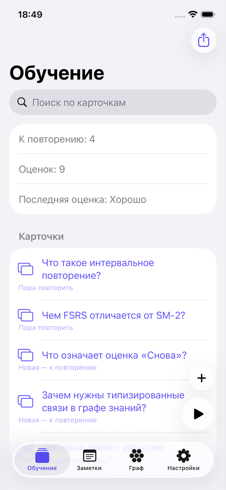
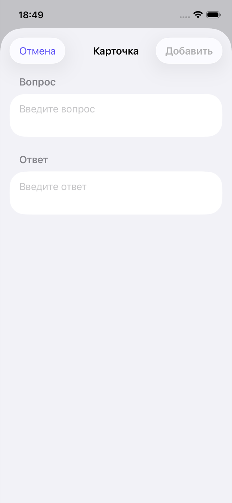
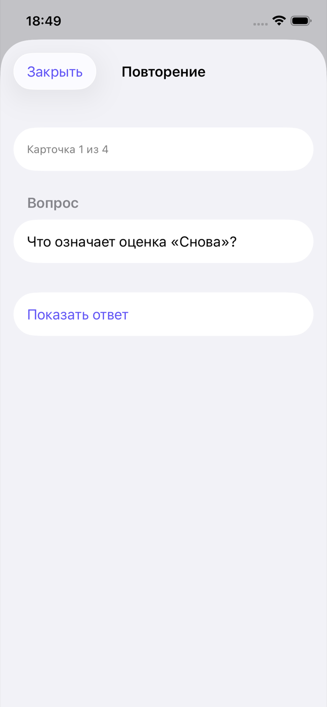
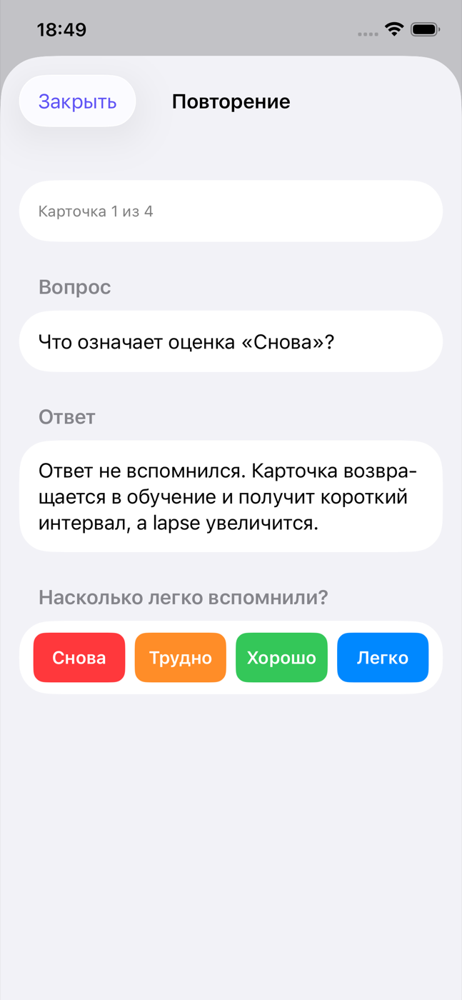
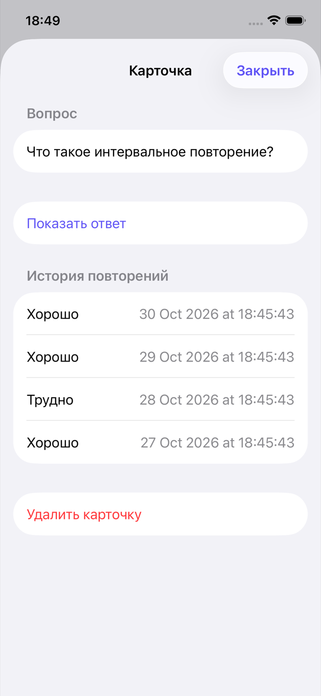
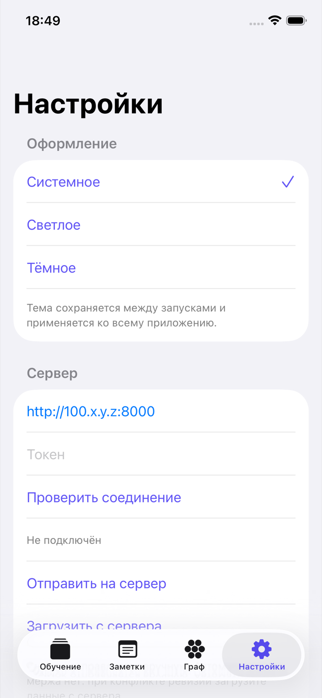
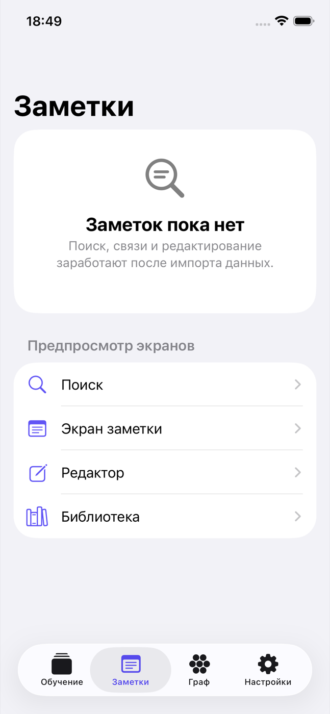
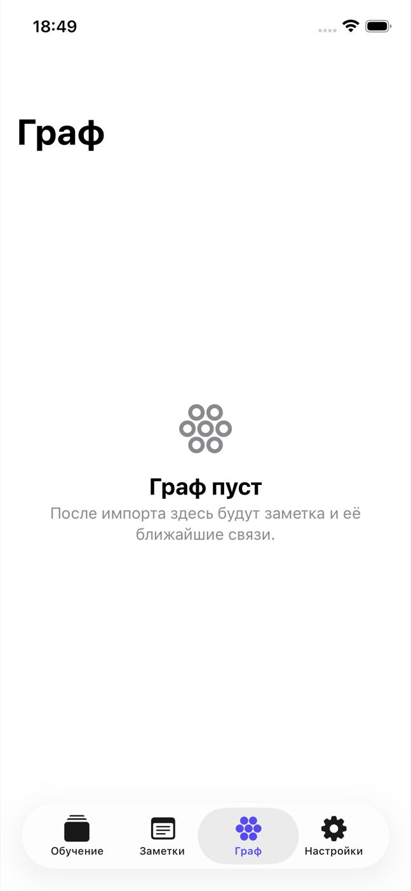

# Kanki

[](https://github.com/EgorYolkin/kanki/actions/workflows/ci.yml)

Kanki — личное приложение для интервального повторения: карточки с вопросом и ответом, расписание по FSRS, история оценок и синхронизация снимка с собственным сервером. Нативный Swift 6 / SwiftUI, один код для iOS 17+ и macOS 14+. Приложение уже используется для ежедневного повторения собственных карточек: оценки, сроки и история сохраняются на устройстве и переживают перезапуск. Заметки, граф знаний и импорт Anki — следующие этапы, поэтому соответствующие экраны пока пустые.

## Что умеет

- **Карточки.** Создание карточки с вопросом и ответом, поиск по обоим полям, удаление с подтверждением: вместе с карточкой удаляются её оценки и FSRS-расписание.
- **Повторение.** В сеанс попадают только новые и просроченные карточки; ответ скрыт до нажатия «Показать ответ». Оценка «Снова / Трудно / Хорошо / Легко» пересчитывает срок через [`swift-fsrs`](https://github.com/open-spaced-repetition/swift-fsrs), после чего сеанс идёт к следующей карточке и заканчивается итогом с разбивкой по оценкам.
- **История и сроки.** Каждая оценка сохраняется с временем; на карточке видна её история, в списке — следующий показ или «Пора повторить».
- **Экспорт.** Меню «Экспорт» сохраняет все карточки или только выбранные в JSON вместе с оценками. Это формат Kanki, а не `.apkg`.
- **Синхронизация снимка.** В настройках задаётся адрес self-hosted сервера и токен: подключение проверяется через `/v1/me`, снимок отправляется и загружается вручную, а при настроенном сервере локальные изменения отправляются автоматически. Обмен защищён ревизией: при устаревшем `base_revision` сервер отвечает `409`, и приложение показывает конфликт вместо слепой перезаписи.
- **Оформление.** Системная, светлая или тёмная тема применяется ко всему приложению и сохраняется между запусками.
- **macOS.** Тот же код собирается в нативное приложение с окном 900×640 и переключением разделов по ⌘1–⌘4. На iOS и macOS 26 системные элементы используют Liquid Glass, на более ранних версиях — стандартные материалы SwiftUI.

## Скриншоты

Сняты на iPhone 17e Simulator (iOS 26.3.1) из сборки ветки `dev` с демонстрационными карточками.

| Обучение | Новая карточка |
| :---: | :---: |
|  |  |

| Сеанс повторения | Ответ и оценки |
| :---: | :---: |
|  |  |

| Карточка и история | Настройки |
| :---: | :---: |
|  |  |

| Заметки | Граф |
| :---: | :---: |
|  |  |

## Как устроено

| Слой | Ответственность |
| --- | --- |
| `Kanki/Domain` | Чистые типы и правила: карточки, оценки, `LearningSnapshot`, FSRS (`CardScheduling`), очередь (`ReviewQueue`), состояние сеанса, поиск, экспорт. Покрыты unit-тестами. |
| `Kanki/Views` | SwiftUI-экраны и только презентационное состояние. |
| `Kanki/LocalCardStore.swift` | Атомарный JSON-снимок `LearningSnapshot` в `Application Support/Kanki/cards.json`: карточки, оценки и FSRS-состояние. Ошибки чтения и записи показываются в интерфейсе, а не подавляются. |
| `Kanki/Server` | HTTP-клиент и хранение токена (Keychain, с файловым fallback в неподписанном симуляторе). |
| `server/` | FastAPI + SQLite WAL, bearer-токены, ревизионный снимок, MCP-инструменты для агентов. |

Сервер не интерпретирует содержимое снимка: он хранит JSON и ревизию, поэтому дельта-обмена и мержа пока нет — только обмен снимком целиком с защитой от конкурентной записи. Контракт описан в [docs/server-protocol.md](docs/server-protocol.md), сервер и деплой — в [server/README.md](server/README.md).

## Запуск

Нужны macOS, Xcode с установленной iOS-платформой и [XcodeGen](https://github.com/yonaskolb/XcodeGen). `project.yml` — источник конфигурации; `Kanki.xcodeproj` хранится в репозитории.

```bash
xcodegen generate
open Kanki.xcodeproj
```

Выберите схему `Kanki` и iOS Simulator. Подпись отключена только для симулятора (`CODE_SIGNING_ALLOWED[sdk=iphonesimulator*]`); сборка для устройства подписывается автоматически. Для macOS выберите destination `My Mac` или соберите из терминала — приложение подписывается ad-hoc и не требует Team ID:

```bash
xcodebuild -project Kanki.xcodeproj -scheme Kanki -configuration Debug \
  -destination 'platform=macOS' build
```

Проверки из терминала — те же, что выполняет CI:

```bash
./scripts/lint.sh          # SwiftLint --strict и markdownlint-cli2
./scripts/test.sh          # unit-тесты KankiTests и порог покрытия 95 % по Kanki/Domain
./scripts/server-test.sh   # FastAPI, SQLite WAL, токены, ревизии, MCP
./scripts/ui-test.sh       # iOS UI-тесты на симуляторе
./scripts/macos-ui-test.sh # macOS UI-тест: окно и ⌘1–⌘4
./scripts/ci.sh            # весь контур целиком
```

`KankiTests` покрывают доменный слой; `KankiUITests` — вкладки, добавление и оценку карточки, поиск, сохранение после перезапуска, очередь повторения, экспорт и настройки. `ServerClientIntegrationTests` выполняет реальный HTTP push/pull только при заданных `KANKI_TEST_SERVER_URL` и `KANKI_TEST_TOKEN`. Для стабильного прогона используйте отдельный симулятор и чистый `-derivedDataPath`. Порог, команды и версии инструментов — в [docs/quality-gates.md](docs/quality-gates.md).

## Установка на личное устройство

Для Personal Team есть локальный [скрипт переподписи](scripts/personal_team.py) ([issue #40](https://github.com/EgorYolkin/kanki/issues/40)); подробные шаги и диагностика — в [руководстве по автоподписи](AUTOSIGN_SCRIPT_GUIDE.md). Он не меняет `project.yml`: для сборки на устройство передаёт Xcode `CODE_SIGNING_ALLOWED=YES`, `CODE_SIGN_STYLE=Automatic`, Team ID и bundle ID.

```bash
python3 scripts/personal_team.py refresh --team-id "$TEAM_ID" --device-id "$UDID" --bundle-id app.kanki.ios --force
```

Нужны вход в Apple Account в Xcode, сопряжённый iPhone/iPad и доступная сессия пользователя; 2FA и права Apple скрипт не обходит. Профиль Personal Team действует 7 дней, поэтому переподпись нужно повторять. LaunchAgent (`install-agent`) запускается ежедневно в 09:00, пропускает попытки в течение пяти дней после успешной установки и повторяет их после сбоя; логи — в `~/Library/Logs/Kanki/`. Переустановка с тем же bundle ID не удаляет данные приложения, но перед изменениями на устройстве лучше сделать резервную копию.

## Ограничения и планы

- Заметки, граф, редактор, поиск по заметкам, библиотека, очередь мержей и конфликтов — экраны-заготовки; данных и действий за ними пока нет.
- Импорта заметок и коллекций Anki, `.apkg` и полного SRS-цикла для импортированных карточек нет. Обмен с Anki не реализован: текущий JSON-экспорт — формат Kanki.
- Синхронизация — только снимок целиком по ревизии: нет дельта-обмена, tombstones, фоновой синхронизации и мержа. При конфликте нужно загрузить снимок с сервера и повторить изменения.
- Контракт данных и состав нотетайпа Anki не заморожены до эксперимента Э1 ([issue #3](https://github.com/EgorYolkin/kanki/issues/3)).
- Возможность custom sync URL в AnkiMobile отдельно не подтверждена.

План этапов и зависимости — в [tasks/plan.md](tasks/plan.md), статус приёмки — в [tasks/todo.md](tasks/todo.md), текущие задачи — в [GitHub Issues](https://github.com/EgorYolkin/kanki/issues).

## Участие

Прочитайте [правила участия](CONTRIBUTING.md), [правила поведения](CODE_OF_CONDUCT.md), [инструкции агентам](AGENTS.md) и [контур качества](docs/quality-gates.md). Любая задача начинается с отдельного GitHub issue: план, границы и проверка ведутся там, затем изменения приходят через коммиты и PR с `Closes #N`. Gitflow: рабочая ветка от `dev` → PR в `dev`; выпуск — отдельный PR `dev` → `main`. Не коммитьте напрямую в `main` или `dev`. История изменений — в [CHANGELOG.md](CHANGELOG.md).
